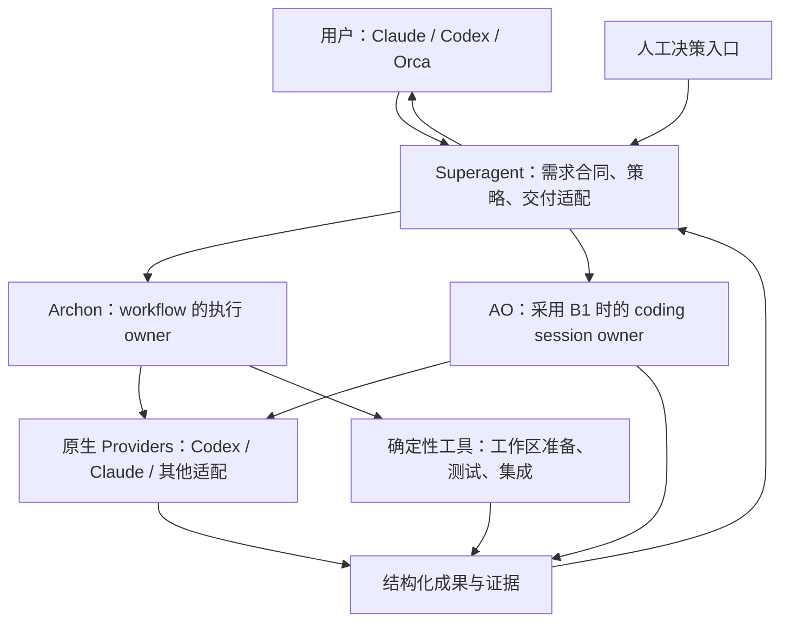

# Superagent 1.0.0：复用优先的任务交付架构

日期：2026-10-14。分支：`1.0.0`，从 `wetamp@52e4030354d56bdff362bcc6a196315f6458664a` 创建。

本文是待评审的设计，不代表实现、升级或部署已完成。设计评审记录单独保存，绑定本文 SHA-256；设计通过与运行时验收分开。

## 1. 问题、目标和结论

问题是 Superagent 长期交付拖拉、角色之间反复传递与探索、环境问题到集成时才暴露，以及任务和人工决策的结果难以追踪。价值是让大小任务以必要的最短路径交付，同时保留权限、质量和恢复保证。现在需要作出架构选择，因为继续增加局部补丁可能让两个执行入口、多个状态副本和反复调度固化。

期望结果：普通小任务一次派工即可进入实测交付；大任务按真实依赖并行；失败只重做失效部分；每项需求、决策与结果都有可追踪证据。性能改善以实际端到端数据确认，不能把高评分或采用开源框架当作提速证明。

**推荐的架构原则是“复用成熟控制面、每个执行对象只有一个 owner、Superagent 只保留产品合同与交付策略”。现役 Archon 暂时保持；优先验证 agent-orchestrator 直接替代自研编码控制面的方案，与继续采用 Archon 公平比较后决定产品装配。**

现役保留是迁移期间的运行安排，不是“Archon 最佳”的结论。AO 已有的派工、工作区、会话与反馈闭环正是应优先复用的资产；不能仅因它是 Go/Electron 完整产品而把它排除。是否组合两个产品，取决于有无窄且可验证的边界，不能先假定必须全部保留，也不能先假定不用 AO。

验收分两层：本文须经过 Codex 与 Claude 的两个全新只读评审会话，各自评分 ≥96，且无未关闭 blocker；后续实现还须满足第 10 节的行为、兼容和性能门槛。本次只交付分支、设计与双审结果。

## 2. 从第一性原理分析为什么慢

任务的产品不是“让三个角色都工作过”，而是满足需求的可验证变更。任何一次模型调用、等待、工作区创建或评审，必须产生下一步所需的新信息，或执行必要的控制。

交付耗时由关键路径决定：`T_delivery = 首次有效候选的关键路径 + 返工关键路径 + 集成/决策等待`。节点内部还包含准入排队、准备、模型/网络往返和工具执行。这些区间可能重叠，不能把并行节点耗时简单相加；重复尝试必须保留在投入统计中。

由此得到五条设计原则：

1. 缩短串行链优先于增加 Agent 数量。没有依赖的工作才能并行，共享工作树写入和最终集成仍须串行。
2. 降低返工优先于降低一次调用的耗时。输入缺失、环境漂移和验收口径不一致会消耗整轮模型往返。
3. 模型速度与编排速度分开测量。框架能减少空等和重复调用，不能直接消除模型服务端延迟。
4. 生命周期只能有一个权威。任务需求、执行 attempt、外部副作用各有自己的事实源；不能让看板或主控的观察改写执行终态。
5. 质量控制按风险加入。元帅、军师、将军是职责，不是每个任务都经过的三个串行站点。

现有证据及其边界：

| 观察                                                                                 | 能支持的判断                                                                  | 不能支持的判断                                        |
| ------------------------------------------------------------------------------------ | ----------------------------------------------------------------------------- | ----------------------------------------------------- |
| 一次原生输入 smoke：Codex 34.902s、Claude 7.840s，两者各一次工具调用                 | 用户看到的速度差距在该样本中存在，约 4.45 倍                                  | 角色、模型、effort 未完全控制，不能宣称普遍快 4.45 倍 |
| 一个 code 节点约 22m21s，63 次工具调用；工具区间并集约 75.318s，工具间隙约 1176.214s | 优化 shell 执行本身不足以解释主要耗时，应减少无效往返并补足 provider 时间边界 | 工具间隙混合模型、网络和客户端，不能称为纯推理时间    |
| 原生任务环境变量被过滤，任务卡曾无法可靠到达执行者                                   | 输入传输缺陷会引发寻找上下文和额外往返；有限 stdin/EOF 修复已提交             | 单个输入修复不等于系统提速完成                        |
| 候选 worktree 配置了 `.husky/_`，但缺少 `pre-commit`；主检出提交时才报 lint          | 工作区准备不一致已造成一次可证实的返工                                        | 不能把全部拖拉归因于 hooks                            |
| 普通 G0/G1 单包首次成功路径已只有一个编码 AI 节点                                    | 应保留现有最短路径                                                            | 不能把“去掉固定三角色流水线”当作尚未实施的新成果      |

上述证据来自本次恢复记录；可重取的源码引用见第 12 节。真实运行记录保留在引擎工作区，不把包含会话内容的日志提交到仓库。

## 3. 两个项目分别提供什么架构价值

| 维度             | agent-orchestrator                                                                | Archon                                                                   |
| ---------------- | --------------------------------------------------------------------------------- | ------------------------------------------------------------------------ |
| 产品定位         | 完整的本地编码控制台：Go daemon 与 Electron/React 桌面应用                        | 可治理的自动化执行引擎，编码是其成熟应用之一                             |
| 核心抽象         | 项目级 orchestrator、focused worker/session、独立 branch/worktree、PR/CI/评审反馈 | workflow/DAG、节点、attempt、持久等待、恢复、事件与工作区生命周期        |
| 最大价值         | 把派工、原生会话、工作区和交付反馈连在同一任务上，减少人工搬运                    | 把依赖、并行、等待、失败和恢复交给确定性执行内核                         |
| 可借鉴机制       | 持久消息队列、revision 冲突、反馈签名去重、claimed dispatch、从事实推导看板状态   | 现成 DAG、执行准入、资源 slots、typed lifecycle、工作区 setup 与审计事件 |
| 与当前系统的关系 | 完整替代候选；不是可直接 import 的 TypeScript 调度库                              | 本仓库本来就是其 fork，已有定制的交付与权限契约                          |
| 未验证部分       | 本机运行、权限/人工 push/旧 run 兼容、对照性能                                    | 新版能力与 fork 的组合兼容、统一入口后的实际性能                         |

agent-orchestrator 的持久反馈去重有价值，但不能直接等同于 exactly-once：发送与持久化之间仍要处理崩溃窗口。其 `reviewMaxNudge=3`，CI/conflict 使用 `maxAttempts=0`；不能据此声称它所有修复循环都有界。

Archon 的价值在于减少需要维护的执行机制。已有的 run/provider/memory/integration 准入分别管理不同对象，不应简单删除成一个大锁；应统一身份与调用入口，让每种资源仍由正确的 owner 管理。

## 4. 方案比较与选择条件

| 方案                                               | 好处                                                                       | 主要代价                                                                 | 决定                     |
| -------------------------------------------------- | -------------------------------------------------------------------------- | ------------------------------------------------------------------------ | ------------------------ |
| A. Archon 唯一内核 + 薄 Superagent                 | 复用现有运行、验收和恢复契约；可以逐步删除重复逻辑；支持多入口与非编码任务 | 仍需收敛 fork 与原生 job 入口，依赖 upstream 演进                        | 现役基线，接受同等对照   |
| B1. AO 接管编码控制面，Archon 保留其他受治理工作流 | 直接复用 AO 派工、会话、工作区和反馈；Archon 专注其成熟的 DAG/等待/恢复    | 跨产品关联、全局配额与交付策略需要窄适配；旧 run 不能搬迁冒充续跑        | 优先验证的目标装配       |
| B2. AO 仅作交互控制面，执行全部委托 Archon         | 保留一个执行内核，同时复用 AO 交互产品                                     | 尚未证明 AO 可通过公开接口委托全部 worker 生命周期；强改 AO 可能等同重写 | 只在公开 seam 可行时考虑 |
| C. 两个框架同时调度同一任务                        | 看似能力齐全                                                               | 两份队列、owner、重试和终态；重复派工与恢复竞态；定位更困难              | 排除                     |
| D. 自建新调度器或引入第三个 durable execution 服务 | 可以自行设计全部细节                                                       | 重做现有能力，增加服务、状态迁移与维护；未证明改善模型延迟               | 排除                     |

两框架的合理组合是 B1：AO 的编码 session/worktree 由 AO 拥有，Archon 的独立工作流由 Archon 拥有，Superagent 只关联需求与交付证据。若编码结果需要 Archon 验证，把不可变候选 tree 作为新的只读验收子工作流输入；Archon 不接管原 AO worker 或重写其状态。共享 provider/具体资源必须在公开 launch seam 接入同一准入 owner，证明不了则试验串行、禁止生产混合并发。B2 不因架构图漂亮就当作已有能力。

M0 即启动 AO 隔离验证：先用 90 分钟核对 native worker、REST/SSE、任务反馈和启动准入 seam，再给一个最多 4 工程小时的薄适配试验。比较分两阶段：先用中性的任务/验收合同测原生编码效率，**不要求先实现现役系统全部契约**；再单列评估权限、人工 push、恢复与交付的产品能力差距及迁移成本。AO 不能因不使用原字段名而失败；同样的行为不变量才是门槛。

选择 B1 的量化条件：同类别配对端到端 p50 比 A 至少快 30%，p90 不劣化 >10%，质量门槛相同；独立维护的自研生命周期/队列/反馈 owner 数至少减少一半，计数清单随报告公开。适配试验不得超过上述时间盒；迁移工作量另列，不混入原生性能。若性能或维护收益尚不明确，保留 A 并报告未知；若 B1 达标，后续实施转向 B1，不再投入 A 的可替代控制面。两者都不达标就优先处理 provider 主瓶颈，不继续造调度器。真正切换前仍须通过治理兼容；时间盒是调查止损，不能计时杀死 live owner。

无论选择哪条路线，每个缺口先查成熟框架公开能力。必要通用修复优先贡献 upstream，产品策略留在 `wetamp/`；上游合并不是本地交付的前提。

## 5. 目标边界与两种装配

| 所属层          | 应承担                                                                                                     | 不应承担                                                          |
| --------------- | ---------------------------------------------------------------------------------------------------------- | ----------------------------------------------------------------- |
| Superagent      | 持久需求与修订、父子覆盖、角色/模型策略、风险门禁、验收合同、串行交付适配、决策解释与回执展示              | 第二个执行状态机、凭时间猜失败、重复实现通用调度器                |
| Archon          | 自己拥有的 workflow 的 DAG、run/attempt、准入/资源租约、取消/等待/恢复、工作区生命周期、持久事件、执行终态 | 猜测业务需求是否完成、把日志文本当授权、接管 AO session           |
| AO（B1）        | 自己拥有的 coding session 的派工、native 会话、worktree、消息队列与反馈闭环                                | 再调度同一个 Archon run、绕过共享准入、以 CI 通过代替完整需求验收 |
| 原生 Provider   | 原生认证与配置、会话、推理、工具执行、真实可用的模型/用量回执                                              | 自行批准门禁、绕过队列派生任务、把 exit 0 当业务验收              |
| Git/CI/测试工具 | 确定性检查、标准机器输出、候选树与提交证据                                                                 | 以测试全绿替代需求覆盖或外部部署确认                              |

图表示可选 B1 装配，A 不启用 AO 分支；两条执行线不共同拥有一个 attempt。需求事实继续由 Intake 拥有，执行事实由对应 Archon run 或 AO session 拥有，外部动作回执由其适配器拥有。`executor kind/executor id/attemptId/task revision/candidate tree` 关联这些事实；看板是投影，不成为另一份事实源。名称是设计中的关联字段概念，新增 wire/schema 字段须先追踪消费者并保持旧数据兼容。

AO 固定版架构已描述 `POST /sessions → Spawn(config)` 及 REST/SSE 控制器，因此产品不同不等于没有集成入口；但认证、去重、取消和 launch hook 的准确协议仍要通过 M0 原型确认，本文不发明一个已可调用的 SDK。下面 §§5.2–6 的 A 路线实现位置适用于现役缺陷；B1 若达标，则改用 AO 的现成 owner，避免两边各修一套。

### 5.1 三角色协同

元帅负责明确目标、约束、拆分和关键决策，按验收合同拍板；将军拥有一次性实现、必要测试和修复上下文；军师只在 G2、strict 或用户明确要求时介入。普通 G0/G1 由主控聚焦实测后交付，不加默认签收。

简单任务不新开规划 Agent；复杂任务只按可独立交付的纵向切片拆包，每个 writer 有独立工作区。评审围绕候选变更和关键需求，不让三角色分别从头读全仓库。修复优先替换/删除，限定净增行数，防止为小问题扩出框架。

模型与 effort 只在 `wetamp/tiers.json` 解析。发起客户端只决定元帅，不应凭入口标签推断实际编码模型更快。将军仍遵守现有 Codex 默认与显式 `single:claude` 例外；模型变更须经受控比较和既有政策批准，不能为了提速静默改厂商或凭据来源。

### 5.2 所有入口使用同一执行责任边界

| 入口                  | 收敛方式                                                         | 特别约束                                                                                |
| --------------------- | ---------------------------------------------------------------- | --------------------------------------------------------------------------------------- |
| `run` / `quick`       | `quick` 继续生成普通合同；复用 run admission、DAG、accept/land   | 不造另一套 fast executor                                                                |
| `job exec`            | 原生 CLI 保留；经现有生命周期/准入 seam 登记、准备、启动、settle | 当前 memory gate 不等于 SDK provider slot；exit 0 不完成父需求                          |
| Claude / Codex / Orca | 输入持久化后由主控 typed 解释为 create/amend/answer              | adapter 不用关键词推断意图；新输入不覆盖旧任务                                          |
| OpenCode 等适配       | 保留 native guidance/config，通过共享执行合同连接                | 未验证入口保持 unknown，不因两端成功宣布全端通过                                        |
| twin-agent 远端       | 保留统一 FIFO；以稳定 request identity 关联本机准入与远端 ticket | 不另建远端队列、不嵌套委派；跨机 lease 无法核实时显式进入 ownership_unknown，不自动再派 |

`ownership_unknown` 在任务详情展示最后可验证的 owner、ticket、观察时间和原因，提供“查询对应 job/恢复连接”“请求 owner 交接”“明确取消并核对副作用”三个动作。人工接管仍须既有授权和引擎对账；不得靠等待超时猜原 owner 已死，也不能让任务无提示消失。

在调用 provider 前登记 dispatch intent，准入成功后才启动；ack 丢失先按 intent 对账。开始执行前和应用结果时均核对当前 owner generation/候选身份。重启不能把未知发起结果当作没启动，取消必须由 owner/engine 确认。

## 6. 解决拖拉的具体机制

### 6.0 首先处理模型往返主耗时

M0 的第一项是 provider 时间边界与受控对照，不等待队列或提醒改造。复用 `jobs.receipt`、engine node timing、native JSONL 事件，关联 `request → 首内容（provider 能提供时）→ 工具请求/返回 → 最终答复`。缺服务端首 token 字段就明确只测客户端边界；网络/服务端/客户端未拆开时仍用“非工具间隙”，不编造推理时间。不增加一次模型调用来解释每个事件。

用同一任务卡、仓库 snapshot、上下文、工具权限与验收，分别测冷/热启动；模型比较与框架比较分开。先做低成本的有限输入/一次工具任务，再做每类一个编码任务。固定并记录 model、effort 与实际可见配置；两个 provider 的 effort 无等价语义时分组报告，不称完全受控。Claude 编码对照通过显式 `single:claude`，不改变默认路由。

对应杠杆是减少无效模型往返、预先送达必要上下文、直接传递已有成果、根据实测选择各角色 model/effort；provider 本身慢且编排占比低时，不再把优化重点放在 scheduler。由现有 tiers/policy owner 承担路由，不新增学习调度器；修改默认模型仍需既有策略决定。主验收是端到端 p50 至少下降 30%，编排子指标只用于定位，不能单独签收提效。

#### 已落地（2026-10-14）

- 上下文预编译（`0f482fcc`）：`code` / `repair` / `fix` 节点首轮内联 `context_pack`，复用运行时上下文生成边界，减少执行者重复读取。
- 效率预算与慢节点报表（`0eff3722`）：报告暴露 attempt 的效率预算、超预算原因及 `slow_nodes`，用于定位耗时，不替代端到端提效验收。
- 作业 / run 新 worktree 自动补齐环境（`d2ce6e83`、`b75070bb`，后续整理 `49b177e7`）：复用共享环境前检与恢复，在 worker 启动前执行所需安装 / prepare 并保留恢复证据。
- Codex 卡死打断续跑（`f7c60f37`）：模型流停滞时有界打断并续跑；工具或子任务仍执行时不触发停滞打断。
- 按模型进展计时（原提交 `19b4141a`，当前历史对应 `ab142c2d`）：停滞计时由模型内容与相关执行进展更新，元数据通知不再续期或饿死超时检查。

### 6.1 先消除已证实的返工

原生任务的 registered input 用有限 stdin 并关闭 EOF，已在当前基线提交；继续保留相关回归。输入合同包含问题、价值、为什么现在、结果、不变量、验收六项，执行者收到定向上下文与证据路径，不收到全量历史。

工作区准备复用 upstream #3973 的 `worktree.postCreate` 和现有 isolation lifecycle。由仓库声明 lockfile 安装及必要检查，生成审计开始/结束/typed failure，启动 worker 前确认准备成功；先在 scratch 验证 setup 的副作用。不要另写 runner 或让 Agent 自己猜准备步骤。工作树隔离不等于安全沙箱。

当前 `job exec --worktree` 仍直接创建 Git worktree，是要收敛的实际缺口。新版改动涉及多文件依赖，不能盲 cherry-pick：先做 fork 兼容检查，通过既有升级流程引入完整依赖闭包，再让 job 调用同一 owner；若未通过，保持旧 runtime，不启用未经验证的替代准备逻辑。

M1 分成前检与初始化两个交付点。先在现有 environment/check owner 检查配置的 hook 文件、lockfile 与必要工具是否可用；缺失明确归为环境阻断，在 worker 启动前给出已存在的安装/prepare 命令，不另写 setup runner。该前检不是完整初始化成功。#3973 升级包先用最多 2 工程小时核对依赖闭包、fork 差异和 scratch 兼容，范围只限 setup 生命周期及其必要依赖；超限或兼容失败就保留前检增量，初始化子项标 blocked，不宣称 M1 全部完成。若 B1 已胜出，初始化优先复用 AO 自身工作区准备 owner。

### 6.2 准入和调度

先复用已有 run admission、provider admission 和 keyed resource slots。相同资源键在本机所有入口共享配额；具体浏览器 profile、端口、测试数据库等资源按对象租约，不扩大为仓库总锁。远端通过现有 FIFO ticket 关联，不能宣称本机锁天然跨机有效。

当前 run 满额会拒绝，原生 job 走 memory gate，两者没有统一的 durable FIFO 保证。目标是在既有 engine admission owner 内接入等待票号、取消与幂等 claim，使用已有持久化适配；未发现可直接复用的 seam 时，先提交最小 upstream 扩展设计，不在 Superagent 建第二 scheduler。排队不预占 provider slot；只在即将启动时取得，释放必须绑定 attempt。

上游是否接受不阻塞本地进度：最多 90 分钟定位 seam，必要时在已有 engine admission owner 做可独立测试的窄 fork 补充，后续再贡献 upstream，不另起队列/数据库。实施卡在定位后冻结文件和行数预算；预算不够就交付可验证的共享容量保护，durable FIFO 保持未完成并提交范围裁决。不得无期限等上游或把拒绝所有任务当作提速；A/B1 的混合准入必须包含旧 runtime 仍占槽时的新启动测试。

先保留 FIFO 的公平性；关键路径任务通过任务拆分和减少无效占槽改善，不立即增加优先级抢占。等待人工决策释放可释放的 worker/provider 资源，保留持久 gate；后续输入只改变未执行部分，执行中变更由引擎边界接纳。

现有 DAG 存在整层 barrier，可能拖延下一就绪节点，但收益尚未证明。只有实测 barrier 是关键路径瓶颈时，才在 Archon 层改为依赖完成即 ready、在容量允许时启动；复用原节点状态、失败传播和恢复语义。独立 worktree 并行，共享 writer 串行，不扩大改动到一套新图语言。

### 6.3 上下文、失败和验收

成果使用现有 typed result 与 artifact reference，绑定 task revision、候选 tree、测试命令/环境和作者链。修复卡只附相关失败、已排除基线、遗留发现和本轮 diff。会话续接只用于有明确 cursor 的被打断工作；新修复会话直接消费证据，不重新调研全仓库。

机械保证由现有 `generate.ts/sa-context` 生成边界承担：schema 验证结果、校验 artifact 身份/hash、按现有 `tiers.policy.dispatch_context` 限制输入大小，必要证据不得被静默截掉；超限转为有边界的文件引用或明确 input_incomplete。`sa-check`/交付适配器核对任务卡冻结的变更文件/净增行数预算，超预算候选不自动集成；只检验结构与身份，不用关键词判断相关性。回归覆盖旧修订证据、错误树、缺必要字段和超预算候选。Agent 是否继续全仓探索无法靠这些约束保证，另外用工具次数和重复读取事件暴露浪费，不把提示词当作强制限制。

原生 guidance/settings/auth 保留；skills/plugins/MCP 按节点显式授权，不通过替换 provider home 省上下文。能力不支持就明确拒绝，不能静默放宽。

先分类产品、测试数据、基线、环境和未知失败；使用 exit code、typed error、JSON 等机器渠道，无法确认则保留 unknown。无候选阻断后不空跑验收。环境失败不派产品修复，同一产品失败最多两轮修复，G2 主线未过不能以已知问题交付。

候选验收继续复用现有 cache，绑定 tree/contract/command/timeout/相关环境。基线探测只有在证明相同 base tree、依赖/setup、命令和环境后才复用，负结果也有身份和失效条件；不能把候选缓存直接当基线缓存。主控最终验证组合候选，`applyLand` 串行核对锁/CAS、树和回执；正式验收不由作者自报替代。

### 6.4 人工决策清楚、有界并有闭环

此项是提效的附属控制，不抢占主执行链的优先级。普通 Git/中低风险已授权操作不新加人工 gate。Mac 系统变更、权限扩大或其他既有红线仍须明确授权；通知失败不能变成默认同意。

每次决策须展示：发起者与任务、待授权的具体动作/对象/范围、为何需要、推荐及依据、“是”的后果、“否”的后果，以及不执行该动作的替代路径。例如“允许为任务 X 安装系统级工具 Y；是=只执行该安装，否=转隔离工作区现有工具；推荐否，因为现有工具足够”。无法给出适用理由时先由主控澄清动作，不盲推一个是/否问题。

复用既有 approval/ask owner，以 gate、action digest、对象和 revision 绑定答案；同一未变化 gate 更新一次，只有动作/风险实质变化才重问。去重不能合并不同对象或权限。推荐仅作解释，不获得授权能力。

回执区分 `已展示 → 已收到答案 → 引擎接受/拒绝 → 动作成功/失败/未执行`，并保留 reason 与 effect receipt。传输不是执行成功，超时不是“否”。既定“勾选=是、删除=否”语义保留：可归属的删除操作记录为否；API 查询失败或只观察到一次 missing 时记 delivery_unknown/pending，在原任务展示一次“无法确认删除答复，请用既有 decide/控制台显式拒绝”，不重推提醒、不执行动作。若现有 adapter 根本无法区分删除与同步缺失，标记已知渠道缺陷，改用用户可见的显式答复入口；永久更改删除语义须另提用户决定，本设计不替用户更改。

## 7. 优点、缺点与弥补

| 架构特性               | 收益                                     | 缺点/风险                             | 弥补方式                                                           |
| ---------------------- | ---------------------------------------- | ------------------------------------- | ------------------------------------------------------------------ |
| 每个执行对象唯一 owner | owner、恢复和终态一致，减少重复实现      | B1 两产品并存增加全局资源关联成本     | 不接管对方 attempt；公开 launch seam 共享准入，无法验证不混合并发  |
| 薄 Superagent          | 多入口共享任务和交付策略，能替换底层     | 任务层与执行层仍要关联                | 显式 revision/attempt/tree 关联和幂等导入，不同步第二份状态        |
| 按风险选角色           | 小任务减少串行往返，大任务保留独审       | 风险低估会漏门禁                      | 结构化 risk + 已有 risk paths，在派发和交付边界校验，歧义升级      |
| 独立 worktree 并行     | 互不覆盖，可独立验收                     | 准备成本、合并冲突、共享依赖资源      | 统一 setup、具体资源租约、最小纵向拆包、串行组合验收               |
| 持久反馈与去重         | 少重复通知、派工和返修                   | 丢 ack 或 crash 窗口可能漏/重复副作用 | intent/claim/receipt 对账；不承诺外部动作 exactly-once，未知先核对 |
| 优先验证 AO 编码控制面 | 直接复用成熟派工与反馈，防止自研路径依赖 | 试验占用时间，AO 迁移成本未明         | 时间盒、独立 scratch、中性合同；治理缺口与迁移成本单列             |
| 复用模型原生配置       | 保留用户认证与 guidance                  | 上下文和能力范围容易扩张              | 只作用域化声明能力；记录实际 context/effort，验证配置两半契约      |

无法保证所有未来错误“绝不发生”。能保证的是：已识别的失败模式进入可执行不变量、故障测试和事件证据；相同违规状态在边界拒绝，回归能被发现与回滚。口头要求和 prompt 不承担这些保证。

## 8. 迁移与回滚，不用重写换提速

先保存固定基线、schema/配置、frozen run、installed runtime 与作者/验收记录。数据库只做 additive 兼容；旧二进制可能仍读写，不能改名、删列或改变已发 wire 值。安装升级和线上改动另按既有授权执行，本次分支不部署。

新 run 在兼容通过后选择新机制；旧 run 继续其冻结执行源与既有 installed 兼容决定，不因为文档写了新方案就拒绝或重开旧 run。原 P4b/F12 的固定 runtime 决策及七项历史运维义务仍由原 Intake 追踪，未证实项保持 unknown；本设计不替代或重置它们。

升级先 dry-run，保留可回退的安装指针与源码。回退只切换未来派发；已发 attempt、租约和外部副作用必须对账后按其 owner 收尾，不能靠杀所有进程或回退数据库恢复。未知 owner 不自动接管。

## 9. 实施顺序与退出条件

| 阶段                     | 交付增量                                                            | 复用位置                                                  | 退出条件                                                                         |
| ------------------------ | ------------------------------------------------------------------- | --------------------------------------------------------- | -------------------------------------------------------------------------------- |
| M0：主瓶颈与产品选择     | 先补 provider 时间边界，做模型/effort 对照和 AO 薄适配验证          | Intake、native/engine 事件、AO REST/SSE                   | §4 时间盒与 §10 分阶段门槛；明确选 A/B1 或未知，不预设赢家                       |
| M1：减少已证实返工       | 原生输入回归 + 同一工作区 setup owner                               | 已提交 stdin 输入修复、upstream #3973/isolation lifecycle | 缺 hooks/依赖先于 worker 暴露；恢复不重复 setup 副作用；小任务一次成功路径可运行 |
| M2：入口准入收敛         | job/run/quick/远端关联，消除配额穿透与 lost-ack 重派                | engine admission/provider slots、twin FIFO                | 所有入口共享同资源配额；并发/取消/崩溃故障测试通过；不重写队列                   |
| M3：按测量优化关键路径   | 模型/effort 与有效上下文优化优先，基线缓存；必要时 ready scheduling | tiers/policy、typed artifacts、现有 cache/DAG             | 端到端主指标下降；只对实际瓶颈改动                                               |
| M4：决策回执与发布前对照 | 明确决策、去重、替代渠道；含 A 与 B1 的最终小中大比较               | existing approval/ask、event feed                         | 决策端到端可追踪，性能/质量达第 10 节门槛                                        |

每阶段先给可用纵向增量，只处理影响关键路径的缺陷；净增行数预算在具体任务卡按已定位 seam 冻结并由交付边界核对。M0 不阻止与路线无关的缺陷前检增量；选择 B1 后，M1–M4 改用其现成能力，不继续改 A 的可替代路径。找不到复用点先裁决范围，不无限调研或堆新抽象。阶段评审依风险，不沿用本文的显式双审作为所有任务的默认成本。

## 10. 如何证明更快且没有牺牲质量

这些是后续实现目标，当前没有达到或测得这些结果。

| 验证面         | 验收办法                                                                                                                                         |
| -------------- | ------------------------------------------------------------------------------------------------------------------------------------------------ |
| 小任务最短路径 | 普通 G0/G1 首次成功：1 个编码 AI 节点、0 默认独审、0 默认人工 gate；保留必要主控实测                                                             |
| 吞吐与交付     | 分阶段取样，见下文；每项在基线/候选相同 snapshot 与中性验收合同上配对运行，模型/effort/caps/硬件保持一致，交替顺序降低时段偏差；模型对照单独分组 |
| 性能目标       | 同类别端到端 p50 降低 ≥30%，p90 不劣化 >10%；编排+准备+重复验证 p50 作为次级定位指标，不代替端到端达标；全部失败/超时/重试计入                   |
| 质量与成本     | 通过相同需求验收集，不新增 blocker、权限越界、重复副作用或遗失需求；全尝试 token 与成本不增加 >10%；缺价格保持 unknown，不推算美元               |
| 统计边界       | 按小/中/大各自判门槛，不用混合分布掩盖退化；报告配对差值、原始分布及 p90 的不稳定性，不宣称长期可靠率或所有任务保证；样本不足保持部分验证        |
| 公平与资源     | 混合 run/job/quick/远端同时争用同资源：容量不超配、FIFO 不饥饿、排队可取消、人工等待不占 provider 执行槽                                         |
| 恢复           | 注入 spawn 前/后 ack 丢失、准备失败、lease 失效、重复事件、进程重启；不能重复派发或把 live/unknown owner 判失败                                  |
| 决策           | 重放同 gate/不同 digest/旧 revision/不同对象；只接受精确绑定答案，展示结果与 effect receipt；通知丢失不授权                                      |
| 交付           | 组合候选主控实测、官方 accept/land 回执、锁/CAS 与人工 push 保留；legacy/frozen/installed 兼容场景通过                                           |
| 入口覆盖       | Claude、Codex、Orca、OpenCode、workflow、native job、twin 分项直接证据；未跑入口不能宣布全引擎完成                                               |

总耗时同时报告需求接收到交付的墙钟时间、必要人工等待和执行者可控时间，不能靠扣除等待美化用户体验。缓存冷热与模型启动分开；provider 无真实时间/模型解析字段时标 unknown，不用配置值冒充服务端实测。

主控拥有基准任务集与最终验收，执行通过现有队列派工。第一阶段只跑 3 对（每类 1 对）作瓶颈筛查，最多 90 分钟与 plan 既有 S/M/L 预算之和的两倍；同时做 AO 同任务原生筛查，算入 §4 的 4 小时适配试验盒，不额外无限扩张。没有价格回执就只报告 token，不估美元。一次聚焦检查通过即前进，不为报告重跑。

通过筛查才在后续真实交付中累计每类 10 对，复用有效基线与事件，不阻塞首个可用增量，也不一次安排 10 对大任务。正式切换前收齐必要样本；接近门槛需扩大样本时另给明确成本/时间预算，不能自动开无限回归。基准环境独立于生产，不为取样重复执行真实外部副作用。

每个配对任务在运行前冻结共同 deadline 和需求分母。未交付/失败任务在截止时记未完成，交付耗时保留为右删失并在门槛计算中按 `+∞` 处理，不用超时值冒充交付；完成率单独报告且不得低于基线。分位数有无穷值就保持该值，不能剔除或借无限基线计算“改善100%”；该类别维持未达标/未知，另看完成率和配对成功样本的辅助分布。后续完成追加原记录，不抹掉截止时未完成状态。

AO 验证先比较中性任务的原生效率，再单列治理能力与迁移成本；原生快不等于可上线，治理差距也不阻止先测原生速度。最终采用门槛按 §4，旧 run 仍由原引擎完成，不要求 AO 伪造 Archon receipt。

## 11. 不遗漏原任务，不把设计当完成

本包新增范围是两个项目的价值比较、最佳架构设计与双审。原 F01–F12、A/B/C/D、P4b 和旧 run 不被取消或重置；完整内容与进度仍从 Intake 分页读取，不能以本表代替原台账。

术语与可复核指针：AO 指 agent-orchestrator；Orca 是用户对话入口，不是另一个执行模型。F01–F12 是原整体重构的稳定需求 ID；历史 A/B/C/D 是原任务的旧分组，不是本文 §4 的候选方案；P4b 指固定 runtime/installed 兼容与历史运维工作包。原完整合同用 `superagent intake show task-ff0bb8f6e6d8af6f0491acd581a100913f2b0ffd73f2a757b560eafaab478bd4`，效率补充用 `superagent intake show task-aed22f769906631e6dd502ecea394177fb81fe0635f65aed864a7642e4dd69d2`；F12/P4b 七项旧运维义务及原证据指针见 `.context/sessions/20261013-075232-sa-upstream-first-refactor/task-stack.md` 与后续恢复栈 `20261014-010222-sa-architecture-m5-continuation/task-stack.md`。会话栈是历史来源，完成状态仍以 Intake 和真实回执为准。

| 既有工作族                           | 本设计对应               | 完成边界                                               |
| ------------------------------------ | ------------------------ | ------------------------------------------------------ |
| F01/F02 需求与持续输入               | §5 需求事实、§5.2 多入口 | 需各入口真实证据；本文只定边界                         |
| F03/F04 交付、身份与恢复             | §5.2、§6.3、§8           | 需 owner/CAS/作者链与正式回执                          |
| F05/F06 失败、上下文与拆包           | §6.1、§6.3               | 需故障测试与返工对照                                   |
| F07/F08 资源、预算与测量             | §6.2、§10                | 需所有入口容量与全尝试样本                             |
| F09 学习闭环                         | §7 可执行回归约束        | 不以 prompt 经验代替测试；旧资格发布/消费/撤回义务保留 |
| F10/F11 seam/schema、upstream 复用   | §4–6、§8                 | 公共 seam 和 schema 单源，不声称已升级                 |
| F12/P4b installed/runtime 与历史运维 | §8                       | 继承原决策，七项原义务不得被本文概括为完成             |

稳定经验检索本次返回 `snapshot integrity/fingerprint failure`，因此未用于设计判断，也不更新记忆或晋升经验。

## 12. 固定来源与评审合同

本次核对的来源，不使用浮动 README 代替版本事实：

- [Archon 固定源码](https://github.com/coleam00/Archon/tree/a5834f2c27af98fe0585964f01e7364844306ad0)，本地 `wetamp/UPSTREAM` pin 为 `b7839d872206ee8f12bc66b8af69ab58ed3b4c6d`；没有升级现役内核。
- [Archon 工作区准备 #3973](https://github.com/coleam00/Archon/commit/d0bb89df992f25dbac0b36e8a696a923d1c6d592)，owner 为 `packages/core/src/workflows/worktree-setup.ts`；另核对 event feed #4012、file store #3947、state docs #3981、fan-out checkout #3965。
- [agent-orchestrator 固定源码](https://github.com/OrchestratorInc/agent-orchestrator/tree/0a7cfdeec766345f21e1483d26e339f4ab10142d)，Apache-2.0；核对 `README.md`、`docs/architecture.md`、`backend/internal/lifecycle/reactions.go`、`backend/internal/service/automation/scheduler.go`、`backend/internal/service/chat/queue.go`。本次不复制源码；未来复用须保留许可证与归属。
- 本地责任边界：`wetamp/src/jobs.ts`、`wetamp/src/intake.ts`、`wetamp/src/generate.ts`、`wetamp/src/execution.ts`、`packages/workflows/src/execution-lifecycle.ts`、`packages/core/src/services/provider-admission.ts`、`packages/core/src/db/resource-slots.ts`。
- 项目约束：[direction](../../.archon/direction.md)、[workflow constitution](../../.archon/workflow-language-constitution.md)、[existing execution architecture](execution-architecture.md)。早期架构文档中的零 fork diff、旧默认沙箱等历史快照不作当前事实。

冻结双审口径：问题/第一性原理 15，项目事实/复用判断 20，职责/安全边界 20，效率机制与角色协同 20，实施/回滚 10，验收/可观测性 10，清晰度/取舍 5，共 100。每个扣分须对应既定需求的缺陷及行号，建议不扣分；任一 blocker 即 FAIL，与总分无关。

两端使用同一本文 hash 和评分口径，各自输出维度分、缺陷台账、总分和结论。R1 全量；如需修订，R2/R3 只核验遗留与本轮 diff、新 blocker，最多三轮，不为凑分放宽口径。结果如实保留；未达 96 或缺实际模型回执不能宣称通过。
